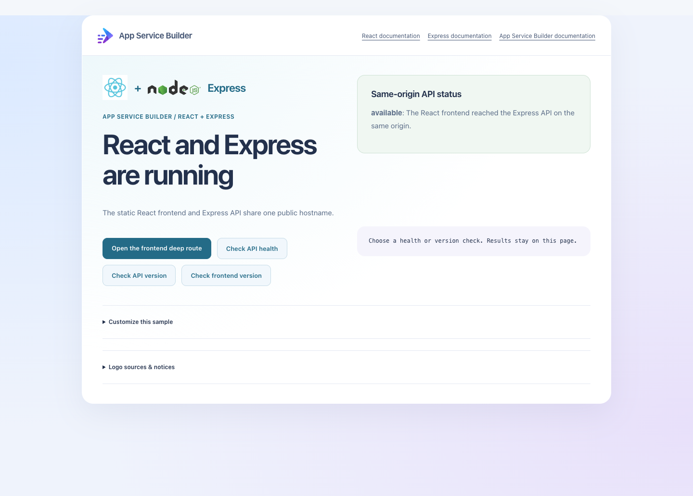

 # App Service Builder: React + Express sample

 ## Local page preview

 

 **LOCAL — Microsoft Edge, 1440px desktop, root `/`.**
 Rendered from the production React build with the real local Express API;
 Azure deployment was not performed or verified. The useful page is at `/`.
 Health and version checks display responses on the page rather than navigate to
 raw endpoints. Expand **Customize this sample** for the files to edit in your own
 fork. App Service Builder and React documentation are named separately.

The paired daylight composition preserves the same-origin API status card,
health/version checks, and React Router paths. Edit `web/src/App.jsx` for content
and `web/public/brand/family.v1.css` for the visual family; baseline styles remain
in `web/src/App.css`. Express documentation is separate from Builder guidance.

### Logo provenance

`web/public/brand/builder.svg` is the supplied official App Service Builder mark.
`react.png` is the unmodified [official React site icon](https://react.dev/apple-touch-icon.png).
`nodejs.svg` is the unmodified [official dark horizontal Node.js SVG](https://nodejs.org/static/logos/nodejsDark.svg),
identifying Express's runtime. React is a trademark of Meta Platforms, Inc.;
Node.js is a trademark of the OpenJS Foundation, subject to its
[trademark policy](https://trademark-policy.openjsf.org/).
Logos identify the stack; no endorsement is implied.

A standalone React frontend and Express API deployed as two components behind
one public hostname with
[Azure App Service Builder](https://builder.appservice.azure.com/docs/). Vite builds
the frontend into static files; Express runs as a separate Node.js process.
The browser calls relative `/api` URLs, so no CORS configuration, database,
external service, or parent workspace is required.

**App Service Builder is in Private Preview. Use this sample for development
and testing, not as a production application template.** The original sample
was successfully deployed with the included manifest and its tested frontend
and API links worked. The renamed repository must still be deployed and verified
in your authorized preview environment. Local checks do not establish cloud
deployment success or regional availability.

## Features

- React Router landing, product, and client-side not-found pages.
- A frontend status card that calls the real Express API and displays failures.
- Separate static frontend and running API components behind one hostname.
- JSON health, availability, application identity, request metadata, and echo routes.
- API unit tests and a same-origin integration test using the real API and built frontend.

## Repository structure

```text
api/                 Express API, package.json, lockfile, source, and tests
web/                 React/Vite frontend, package.json, lockfile, and public metadata
builder.yaml         Two-component routing and runtime configuration
fullstack.test.mjs   Standalone integration checks
scripts/verify.ps1   Local or deployed HTTP verification
```

Each component has its own dependencies and lockfile. There is intentionally
no root `package.json`; use the component commands below from the repository root.

## Prerequisites

- [Node.js 24 LTS](https://nodejs.org/) and its bundled npm are recommended.
- [Git](https://git-scm.com/) and a GitHub account.
- For deployment: App Service Builder Private Preview access, an authorized
  Azure subscription, and an existing resource group in a supported preview
  location.
- Optional: [PowerShell 7](https://learn.microsoft.com/powershell/scripting/install/installing-powershell)
  for the endpoint verification script.

The lockfiles contain React **19.3.0**, Vite **8.3.1**, React Router **7.18.4**,
and Express **5.1.0**. Keep both lockfiles and use `npm ci` to install the
locked versions rather than updating dependencies during setup.

## Run locally

Fork
[AzureAppService/app-service-builder-react-express](https://github.com/AzureAppService/app-service-builder-react-express/fork)
to your GitHub account. Clone your fork, replacing `<your-github-account>`:

```sh
git clone https://github.com/<your-github-account>/app-service-builder-react-express.git
cd app-service-builder-react-express
npm --prefix api ci --ignore-scripts
npm --prefix web ci --ignore-scripts
```

### Start the API

In PowerShell, from the repository root:

```powershell
$env:PORT = "18089"
npm --prefix api start
```

On Linux or macOS:

```sh
PORT=18089 npm --prefix api start
```

The API reads `PORT`, defaults to `8080`, and binds to `0.0.0.0`. Use it only
on a trusted development network. Port `18089` is the local convention used by
the Vite proxy; the deployed API listens on component port `8080`.

### Start the frontend

In a second terminal, from the repository root:

```sh
npm --prefix web run dev -- --host 127.0.0.1 --port 5173 --strictPort
```

Open `http://localhost:5173/`. Expect the heading
`React and Express are running` and an API card displaying `available` with
`The React frontend reached the Express API on the same origin.`

The browser requests `/api/status` on the frontend origin. Vite proxies `/api`
to `http://127.0.0.1:18089` without removing the prefix. Keep the API running;
if it is unavailable, the status card should show `error`, not a successful
connection. Stop each process with Ctrl+C.

If you change the API port, set `API_PROXY_TARGET` in the frontend terminal
before starting Vite. For example, when the API is listening on port `18090`:

```powershell
$env:API_PROXY_TARGET = "http://127.0.0.1:18090"
npm --prefix web run dev -- --host 127.0.0.1 --port 5173 --strictPort
```

`API_PROXY_TARGET` affects local development and preview only. It is not a
browser environment variable or a required Builder setting.

## Test and build

From the repository root:

```sh
npm --prefix api test
npm --prefix web run lint
npm --prefix web run build
node --test fullstack.test.mjs
```

The API tests cover health, identity, JSON echo, filtered request metadata, and
missing API routes. The integration checks verify the manifest, static output,
frontend deep links, generated assets, JSON endpoints, echo requests, and API
404 responses through the same local origin.

Integration tests start a loopback-only API and Vite preview on available ports,
then stop both. They do not require your manually started servers. Install
both components and build the frontend before running them. GitHub Actions
runs these checks on Linux and Windows with Node.js 24.

### Preview the production frontend

Keep the API running on port `18089`, then use a second terminal:

```sh
npm --prefix web run build
npm --prefix web run preview -- --host 127.0.0.1 --port 8080 --strictPort
```

Open `http://localhost:8080/`. Vite preview serves the built `web/dist/` files
and proxies `/api` to the local API. This is a local check, not a production
server to deploy.

With both processes running, optionally check the local or deployed URL using
PowerShell 7:

```powershell
pwsh -NoProfile -File .\scripts\verify.ps1 -BaseUrl http://localhost:8080
```

The script checks HTTP responses and an echo request; it does not execute
React. In a browser, also verify the API status card, in-app navigation,
direct navigation to `/products/widget-1`, refreshing that route, and the
unknown route's `Page not found` heading.

## Routes and prefix ownership

| Route | Expected behavior |
|---|---|
| `/` | HTTP 200 shell; React renders the landing page and API status card |
| `/products/widget-1` | HTTP 200 shell; React Router renders `Widget 1` |
| `/unknown-client-route` | HTTP 200 shell; React Router renders `Page not found` |
| `/version.json` | HTTP 200, static frontend identity JSON |
| `GET /api/health` | HTTP 200, API health and identity JSON |
| `GET /api/status` | HTTP 200, API availability, message, and timestamp |
| `GET /api/version` | HTTP 200, API/framework/runtime identity and public markers |
| `GET /api/request` | HTTP 200, selected request metadata |
| `POST /api/echo` | HTTP 200, JSON body returned under `received` |
| `/api/missing` | HTTP 404, JSON API error rather than the SPA shell |

The frontend owns non-API routes. Browser History API deep links require the
static host to return `index.html`; unknown client routes then render a
not-found page with HTTP status 200. The `/api` prefix must take precedence
over that fallback. Verify both behaviors after deployment.

The API routes are public and unauthenticated. JSON bodies are limited to
16 KB; do not send credentials or private data to the echo endpoint.
`/api/request` returns only host, user-agent, and forwarded-protocol headers,
not authorization or cookie headers.

## Deployment contract

The repository root contains `builder.yaml`:

```yaml
components:
  - name: web
    rootDirectory: web
    path: /

  - name: api
    rootDirectory: api
    role: web
    platform: nodejs
    path: /api
    run:
      port: 8080
      start: npm start
      healthCheckPath: /api/health
```

Vite detection supplies the frontend's Node.js build toolchain, production
build, static role, and `dist` output relative to `web/`. Node.js does not run
a frontend development server in the deployment. The API component installs
its own dependencies and starts Express through `npm start`.

Keep the full `/api` prefix in the backend routes; the application does not
depend on a local-only rewrite. Do not select only `web/` or `api/` as the
repository source root, or publish source files as static output.

## Deploy your fork through Builder Portal

Follow the [Portal quickstart](https://builder.appservice.azure.com/docs/quickstarts/portal/)
for your authorized Private Preview environment:

1. Commit and push the sample to the `main` branch of your GitHub repository.
   Builder uses committed GitHub source, not local files.
2. Open Builder Portal and select your enabled subscription, existing resource
   group, and supported preview location.
3. Connect GitHub and authorize the Builder GitHub app to access your repository.
   Obtain organization-owner approval if required.
4. Create an app using your repository, branch `main`, and the repository root
   as its source directory. Keep both component folders and `builder.yaml`.
5. Explicitly start deployment and wait for a successful terminal status.
   Connecting a source or pushing a commit is not proof of deployment.
6. Open the returned runtime URL and confirm the API status card reports
   `available`. Check `/version.json`, `/api/health`, and `/api/version`.
7. Open and refresh the frontend product route. Confirm an unknown frontend
   route renders `Page not found`, while `/api/missing` returns HTTP 404 JSON.

### Public API markers and updates

The optional `DEPLOYMENT_MARKER` and `RUNTIME_MARKER` variables are read by
the running API and returned by `/api/version`. `DEPLOYMENT_MARKER` also
appears in `/api/health`. Both default to `local` and are intentionally public.
**Never put credentials, connection strings, or private information in them.**

Configure these values for the API through Portal **Variables**, then deploy
to apply them to the running application. Saving variables alone does not
establish that the active deployment changed. See the
[variables guide](https://builder.appservice.azure.com/docs/guides/variables/).
The frontend's static version JSON does not read runtime variables.

For code changes, run the tests and production build, commit, and push to your
fork's `main` branch. Explicitly deploy through Builder Portal, wait for
completion, and verify frontend and API together. Automatic deployment on push
is not qualified by this sample.

### Cleanup

Delete only the Builder app you created and wait for deletion to complete.
Do not delete a shared resource group, subscription, or unrelated resources.
Deleting the app does not delete your GitHub repository or local clone.

## Resources and contributions

- [App Service Builder documentation](https://builder.appservice.azure.com/docs/)
- [Sample catalog](https://builder.appservice.azure.com/docs/samples/)
- [Manifest guide](https://builder.appservice.azure.com/docs/guides/builder-yaml/)
- [Contributing](CONTRIBUTING.md)
- [Code of Conduct](.github/CODE_OF_CONDUCT.md)
- [Security reporting](SECURITY.md)
- [Changelog](CHANGELOG.md)
- [MIT license](LICENSE.md)
